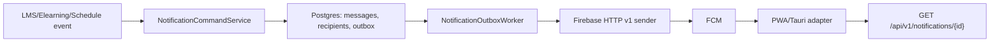

# BE Plan - Firebase Push Notification cho ERG

Ngày cập nhật: 2026-06-10, Asia/Saigon

Phạm vi: `D:\ERG\erg-spring`

Mục tiêu tải tối thiểu: 10.000 user, 5.000 concurrent user, PWA trước, Tauri desktop sau, native image là hướng production dài hạn.

## 1. Kết luận kiến trúc

Firebase Cloud Messaging chỉ là provider giao push. PostgreSQL của `erg-spring` là source of truth cho inbox, trạng thái đọc, device registry, outbox, retry, audit và idempotency.

Luồng chuẩn:



Quyết định quan trọng:

- Không dùng `firebase-admin` làm production default vì BE sẽ đi native image.
- Default sender là HTTP v1 bằng JDK `HttpClient`.
- Không gửi FCM inline trong transaction nghiệp vụ.
- Notification nào cũng có record trong DB trước khi gửi push.
- Self API, device API và admin API tách route và tách quyền.
- Topic luôn có namespace tenant, không nhận raw topic cross-tenant.

## 2. Tài liệu tham khảo đã kiểm ngày 2026-06-10

- FCM HTTP v1 API: https://firebase.google.com/docs/cloud-messaging/send/v1-api, last updated 2026-06-09 UTC.
- FCM token management: https://firebase.google.com/docs/cloud-messaging/manage-tokens, last updated 2026-06-09 UTC.
- FCM topic messaging: https://firebase.google.com/docs/cloud-messaging/topic-messaging, last updated 2026-06-09 UTC.
- FCM scale best practices: https://firebase.google.com/docs/cloud-messaging/scale-fcm, last updated 2026-06-09 UTC.
- FCM throttling and quotas: https://firebase.google.com/docs/cloud-messaging/throttling-and-quotas, last updated 2026-06-09 UTC.
- Spring Boot 4.0.6 native image advanced topics: https://docs.spring.io/spring-boot/reference/packaging/native-image/advanced-topics.html.
- GraalVM Native Image reachability metadata: https://www.graalvm.org/latest/reference-manual/native-image/metadata/.

Áp dụng vào thiết kế:

- HTTP v1 gửi `POST https://fcm.googleapis.com/v1/projects/{projectId}/messages:send` với `Authorization: Bearer`.
- FCM HTTP v1 quota dùng token bucket, ví dụ 600K quota token mỗi 1 phút/project, nhưng vẫn phải tự dàn tải và xử lý 429.
- Topic phù hợp broadcast throughput, không phù hợp dữ liệu riêng tư hoặc delivery cá nhân cần latency thấp.
- Một app instance tối đa 2.000 topic; batch subscription tối đa 1.000 app instances/request; subscribe/unsubscribe topic bị giới hạn 3.000 QPS/project.
- FCM khuyến nghị chỉ có một fanout lớn đang chạy để tối đa tốc độ.
- Token stale mặc định sau 1 tháng không kết nối; invalid target như `UNREGISTERED` hoặc payload hợp lệ nhưng `INVALID_ARGUMENT` phải deactivate local mapping.
- Native image cần RuntimeHints/reachability metadata cho reflection/resource/dynamic access; không được đóng gói service account JSON vào binary.

## 3. Trạng thái đã triển khai trong BE

Các file chính đã thêm hoặc thay đổi:

- Migration: `src/main/resources/db/migration/postgres/V10__firebase_push_notifications.sql`
- Entity: `model/notifications/NotificationMessageEntity`, `NotificationRecipientEntity`, `NotificationDeviceRegistrationEntity`, `NotificationOutboxEntity`, `NotificationDeliveryAttemptEntity`, `NotificationTopicMembershipEntity`, `NotificationPreferenceEntity`
- Repository: `repository/notifications/*Repository.java`
- Controller:
  - `controller/notifications/NotificationController.java`
  - `controller/notifications/NotificationDeviceController.java`
  - `controller/notifications/NotificationAdminController.java`
- Service:
  - `service/notifications/NotificationService.java`
  - `service/notifications/NotificationDeviceService.java`
  - `service/notifications/NotificationCommandService.java`
  - `service/notifications/NotificationOutboxWorker.java`
  - `service/notifications/NotificationSecuritySupport.java`
- Firebase/native boundary:
  - `notifications/config/NotificationPushProperties.java`
  - `notifications/config/FirebaseNotificationConfiguration.java`
  - `notifications/config/FirebaseNotificationRuntimeHints.java`
  - `notifications/push/FirebaseHttpV1PushSender.java`
  - `notifications/push/ServiceAccountAccessTokenProvider.java`
  - `notifications/push/StaticAccessTokenProvider.java`
- JPA scan đã thêm `repository.notifications` và `model.notifications` trong `PostgresJpaConfig`.
- Security đã tách:
  - `/api/v1/admin/notifications/**`: cần `notifications.manage` và portal `admin`
  - `/api/v1/notification-devices/**`: authenticated
  - `/api/v1/notifications/**`: authenticated self API

## 4. API contract hiện tại

### Self notification API

`GET /api/v1/notifications?portal=lms&status=unread&page=0&size=20`

- Authenticated.
- Không cần `notifications.manage`.
- Scope bắt buộc: `tenantId + userId + portal`.
- `status`: `all`, `unread`, `read`.
- Kết quả trả `PageResponse<NotificationItemResponse>`.

`GET /api/v1/notifications/unread-count?portal=lms`

- Đếm unread theo `tenantId + userId + portal`.

`GET /api/v1/notifications/{id}?portal=lms`

- `id` có thể là recipient id hoặc notification id.
- Service vẫn lọc portal để tránh session `lms` đọc notification portal khác.

`PATCH /api/v1/notifications/{id}/read?portal=lms`

- Mark read theo owner và portal.

`PATCH /api/v1/notifications/read-all?portal=lms`

- Mark read tất cả notification chưa archived của user trong portal.

`DELETE /api/v1/notifications/{id}?portal=lms`

- Soft archive bằng `archived_at`.

`GET /api/v1/notifications/preferences?portal=lms`

`PUT /api/v1/notifications/preferences`

- Upsert theo `tenantId + userId + portal + eventType`.

### Device API

`POST /api/v1/notification-devices`

```json
{
  "portal": "lms",
  "platform": "web_pwa",
  "firebaseInstallationId": "fid-or-null",
  "registrationToken": "compat-token-or-null",
  "serviceWorkerScope": "/",
  "permissionState": "granted",
  "locale": "vi-VN",
  "timezone": "Asia/Saigon",
  "client": {
    "browserName": "Chrome",
    "browserVersion": "126",
    "osName": "Android",
    "userAgent": "..."
  }
}
```

Behavior:

- Cần ít nhất FID hoặc registration token.
- `userId` lấy từ principal, không nhận từ body.
- Upsert theo `(tenant_id, firebase_installation_id)` nếu có FID, fallback theo token hash.
- Không cho rebind active device đang thuộc user khác.
- Device đã revoked/disabled có thể được bind lại sau logout/unregister hợp lệ.
- Tạo topic membership `t_{tenant}_portal_{portal}` local-side.

`POST /api/v1/notification-devices/unregister`

```json
{
  "portal": "lms",
  "firebaseInstallationId": "fid",
  "registrationToken": "compat-token"
}
```

- Chỉ revoke nếu đúng `tenantId + userId + portal`.

`POST /api/v1/notification-devices/heartbeat`

```json
{
  "portal": "lms",
  "deviceRegistrationId": "device-id",
  "permissionState": "granted"
}
```

- Cập nhật `last_seen_at`.
- Không chạm device khác portal.

`DELETE /api/v1/notification-devices/{deviceId}?portal=lms`

- Chỉ revoke device của current user trong portal đó.

### Admin API

`POST /api/v1/admin/notifications/send`

```json
{
  "idempotencyKey": "schedule:sch-1:published:v1",
  "eventType": "SCHEDULE_PUBLISHED",
  "sourceType": "schedule",
  "sourceId": "sch-1",
  "title": "Lịch học mới",
  "bodyPreview": "Bạn có lịch học mới.",
  "actionUrl": "/lms/schedule",
  "priority": "normal",
  "portal": "lms",
  "userIds": ["teacher-1"],
  "topicName": null,
  "data": {
    "kind": "schedule"
  }
}
```

Guard:

- Route cần `notifications.manage`.
- Phải có ít nhất `userIds` hoặc `topicName`.
- `topicName` nếu có phải nằm trong namespace tenant hiện tại: `t_{tenant}_...`.
- `data` không được dùng key hệ thống: `notificationId`, `eventType`, `tenantId`, `portal`, `sourceType`, `sourceId`, `deeplink`, `deviceRegistrationId`.

`GET /api/v1/admin/notifications/stats`

- Tenant-scoped, không đếm toàn bảng.

`POST /api/v1/admin/notifications/outbox/run`

- Manual run tenant-scoped cho tenant hiện tại.
- Scheduled worker vẫn có thể xử lý toàn hệ thống.

## 5. Schema V10

Bảng đã tạo:

- `notification_messages`: nội dung, source, event, payload data, dedupe.
- `notification_recipients`: inbox/read/archive theo user và portal.
- `notification_device_registrations`: FID/token compatibility, hash, permission, last seen.
- `notification_outbox`: target, payload, status, attempts, lease.
- `notification_delivery_attempts`: audit kết quả gửi từng attempt.
- `notification_topic_memberships`: mapping device-topic local.
- `notification_preferences`: preference theo user/portal/event.

Index quan trọng:

- Inbox: `(tenant_id, user_id, portal, status, created_at DESC)`
- Unread count: `(tenant_id, user_id, portal, status)`
- Device active: `(tenant_id, user_id, portal, enabled, last_seen_at DESC)`
- Outbox pickup: `(status, next_attempt_at, created_at)`
- Topic: `(tenant_id, topic_name, membership_status)`
- Dedupe: unique `(tenant_id, dedupe_key)`

Lưu ý production:

- Migration đang tránh partial index để test H2 không gãy.
- Postgres production nên cân nhắc partial unique index cho nullable `dedupe_key`, `firebase_installation_id`, `registration_token_hash` ở migration sau nếu H2 compatibility được tách khỏi migration production.
- `registration_token` đã có lớp bảo vệ at-rest qua `NotificationTokenCipher`: khi cấu hình `NOTIFICATIONS__PUSH__REGISTRATION_TOKEN_ENCRYPTION_KEY`, device registry và outbox lưu ciphertext dạng `enc:v1:*`; worker decrypt trước khi gọi FCM. Local/dev vẫn hỗ trợ plaintext để migrate dần, và có flag `NOTIFICATIONS__PUSH__REGISTRATION_TOKEN_ENCRYPTION_REQUIRED=true` để fail-fast ở production.

## 6. Firebase sender và native image

Production default:

- `FirebaseHttpV1PushSender`
- `AccessTokenProvider`
- JDK `HttpClient`
- `tools.jackson.databind.ObjectMapper`
- Không thêm `firebase-admin` dependency.

Credential mode:

- `FIREBASE_STATIC_ACCESS_TOKEN`: smoke/dev only.
- `GOOGLE_APPLICATION_CREDENTIALS`: service account JSON mount ngoài binary.
- Không có credential: app vẫn boot, sender trả retryable `ACCESS_TOKEN_MISSING`.

Native image stance:

- Business service chỉ phụ thuộc `FirebasePushSender`.
- `firebase-admin` chỉ được xem là adapter optional sau này, không đưa vào native production mặc định.
- `FirebaseNotificationRuntimeHints` đã dùng `ACCESS_DECLARED_FIELDS` thay cho deprecated `DECLARED_FIELDS`.
- Service account JSON không nằm trong classpath và không đóng gói vào binary.

Các gate bắt buộc trước production native:

```powershell
.\mvnw.cmd -DskipTests compile
.\mvnw.cmd "-Dtest=Notification*Test,AccessControlSecurityTest" test
.\mvnw.cmd -Pnative -DskipTests native:compile
.\target\erg-spring.exe --spring.profiles.active=native-smoke
```

Native smoke tối thiểu:

- Boot với `erg.notifications.push.enabled=false`.
- Boot với HTTP v1 sender nhưng không credential, app không crash.
- Boot với service account staging.
- Gửi 1 notification test đến registration token staging.
- Invalid token bị disable local registration.

## 7. Outbox worker

Thiết kế hiện tại:

- `@Scheduled` gọi `runDueBatch()`.
- Claim outbox bằng transaction ngắn, set `status=processing`, `locked_by`, `locked_at`.
- Gửi FCM ngoài transaction claim để không giữ DB lock khi chờ mạng.
- Ghi result bằng transaction riêng.
- Query pickup dùng `FOR UPDATE SKIP LOCKED`.
- `processing` quá `leaseTimeout` được pick lại.
- Manual admin run chỉ pick tenant hiện tại.

Status:

- `pending`: chờ gửi lần đầu.
- `processing`: worker đã claim.
- `retry`: retryable failure.
- `sent`: thành công.
- `failed`: non-retryable invalid target.
- `dead`: hết attempt hoặc lỗi không retry.

Retry:

- 429/5xx/IO/timeout: retry.
- Có `Retry-After`: ưu tiên giá trị provider.
- Không có `Retry-After`: exponential backoff từ `initialBackoff` đến `maxBackoff`.
- `UNREGISTERED`, `NOT_FOUND`, `INVALID_ARGUMENT`: mark failed và disable device nếu có `deviceRegistrationId`.

Đã bổ sung:

- Retry có jitter ngẫu nhiên để tránh retry herd.
- Micrometer metrics nền cho created, recipients, outbox gauges, send result/latency và stale cleanup.
- Stale device cleanup job theo `erg.notifications.push.stale-registration-age`, mặc định 30 ngày.

Điểm còn thiếu:

- Chưa có DLQ admin detail/resend nâng cao.
- Chưa có provider-level rate limiter/delivery window cho broadcast lớn.

## 8. Security hardening đã áp dụng

Các lỗi đã xử lý:

- Self detail/read/archive đã có portal scope, tránh session `lms` đọc notification portal khác.
- Device heartbeat/unregister/revoke đã có portal scope.
- Device register không rebind active device của user khác.
- Admin stats và manual outbox run đã tenant-scoped.
- Admin topic phải có prefix tenant namespace.
- Admin payload không được override reserved data keys.

Test đã thêm:

- `AccessControlSecurityTest`: self notification route, portal rejection, admin route require permission/admin portal.
- `NotificationCommandServiceTest`: tenant topic guard, reserved payload guard, topic outbox creation.
- `NotificationDeviceServiceTest`: active device rebind guard, portal mismatch guard.

## 9. Event catalog V1

Ưu tiên tích hợp sau khi module nền ổn định:

| Event | Nguồn | Recipient resolver | Ghi chú |
| --- | --- | --- | --- |
| `TEACHER_SCHEDULE_ASSIGNED` | WorkShift command future | `WorkShift.userId` | Dùng cho giao thời khóa biểu GV |
| `TEACHER_SCHEDULE_UPDATED` | WorkShift command future | `WorkShift.userId` | Có collapse key theo schedule |
| `TEACHER_SCHEDULE_CANCELLED` | WorkShift command future | `WorkShift.userId` | High priority |
| `ASSIGNMENT_CREATED` | Assignment command future | student auth user id theo class/direct assignment | Chưa hook controller placeholder |
| `ASSIGNMENT_DUE_SOON` | scheduled job | students chưa nộp | Cần query due window |
| `ASSIGNMENT_OVERDUE` | scheduled job | students + teacher/support | Dùng projection missing/late hiện có |
| `ATTEMPT_SUBMITTED` | `LmsRuntimeService.submitAttempt` sau save | `Assignment.assignedBy` | Hook bằng `AFTER_COMMIT`, không entity listener |
| `SUPPORT_NEEDED_LOW_SCORE` | attempt scoring future | teacher/support | Dedupe theo attempt id |
| `ANNOUNCEMENT_PUBLISHED` | announcement persistence future | school/class/student topic | Chưa làm vì `Announcement` chưa có table/entity |

Không nên hook push vào entity listener. Nên dùng command service hoặc domain event sau commit.

## 10. Scale plan 10.000 user / 5.000 concurrent

Giả định:

- 10.000 user, 1-3 device/user: 10.000-30.000 registrations.
- 5.000 concurrent chủ yếu đọc inbox/unread, không phải cùng lúc gửi push.
- Burst lớn nhất là lịch học, thông báo trường/lớp, bài tập hoặc bài nộp.

Chiến lược:

- Broadcast tenant/portal/role/school/class dùng topic.
- Notification cá nhân dùng direct registration token compatibility hiện tại.
- Không fanout tất cả user bằng direct token nếu có thể dùng topic.
- Outbox poll size mặc định 200, max 500.
- Worker scale ngang được nhờ `SKIP LOCKED`.
- Inbox query dùng index tenant/user/portal/status/created.
- Unread count sau này nên cache Redis 15-30 giây.
- Push payload tối đa 4096 bytes, chỉ chứa ID/deeplink, detail fetch từ BE.

Load test cần có trước go-live:

- Inbox list: 500 RPS trong 10 phút, p95 dưới 300ms.
- Unread count: 1.000 RPS với Redis cache, p95 dưới 80ms.
- Device register: 100 RPS, không duplicate.
- Outbox direct: 30.000 targets trong 5 phút với fake sender.
- Topic broadcast: 100 topic sends, không chạy nhiều fanout lớn đồng thời.
- Chaos: fake FCM trả 429/500/timeout, worker retry đúng.

## 11. Observability cần bổ sung

Metrics:

- `notifications.created.count{eventType,portal}`
- `notifications.recipients.count{eventType,portal}`
- `notifications.outbox.pending`
- `notifications.outbox.retry`
- `notifications.outbox.dead`
- `notifications.send.success.count{targetKind}`
- `notifications.send.failure.count{errorCode,targetKind}`
- `notifications.send.latency{targetKind}`
- `notifications.registration.active.count{portal,platform}`
- `notifications.registration.stale.count`

Logs:

- Có `tenantId`, `notificationId`, `outboxId`, `eventType`, `requestId`.
- Không log raw registration token/FID; chỉ log hash hoặc id nội bộ.

Alerts:

- Pending outbox > 5.000 trong 10 phút.
- Dead > 1% trong 15 phút.
- Firebase 429 > 1% trong 5 phút.
- Invalid target > 10% trong 1 giờ.
- Worker không chạy > 2 phút.

## 12. Backlog còn lại trước production

Đã hoàn tất thêm:

- Bảo vệ `registration_token` at rest bằng AES-GCM opt-in qua `NOTIFICATIONS__PUSH__REGISTRATION_TOKEN_ENCRYPTION_KEY`.
- Thêm fake HTTP server test cho `FirebaseHttpV1PushSender`.
- Thêm stale device cleanup job 30 ngày.
- Thêm Micrometer metrics nền.
- Thêm jitter vào retry.

Must fix:

- Thêm Postgres/Testcontainers test cho `FOR UPDATE SKIP LOCKED` và lease recovery.
- Thêm retention policy cho `notification_delivery_attempts`.
- Thêm native compile/smoke trong CI.

Should fix:

- Topic subscribe/unsubscribe với Firebase backend, hiện mới lưu local membership.
- Admin cancel/resend/detail delivery attempts.
- Redis cache cho unread count.
- Rate limiter provider-level.
- Batch/chunk direct token sends nếu sau này gửi multicast thay vì từng outbox target.
- Native profile `native-smoke`.

Later:

- Hook event LMS thật.
- Announcement persistence.
- Tauri desktop notification adapter.
- BigQuery/Data API delivery analytics nếu cần vận hành lớn.

## 13. Definition of Done BE

BE được coi là đạt khi:

- User thường đọc inbox của chính mình mà không cần `notifications.manage`.
- User không đọc/mark/archive notification của user hoặc portal khác.
- Device register/heartbeat/unregister idempotent và không rebind trái phép.
- Admin route cần `notifications.manage` và portal `admin`.
- Admin stats/outbox/topic không vượt tenant boundary.
- Mọi notification tạo qua command service có message, recipient và outbox record bền vững.
- FCM fail không làm transaction LMS fail.
- Worker retry đúng với 429/5xx và disable invalid target.
- Native image build và boot được với HTTP v1 sender.
- Load test đạt 10.000 user/5.000 concurrent theo KPI.
- Có metrics, alerts, runbook và kill switch `erg.notifications.push.enabled=false`.
