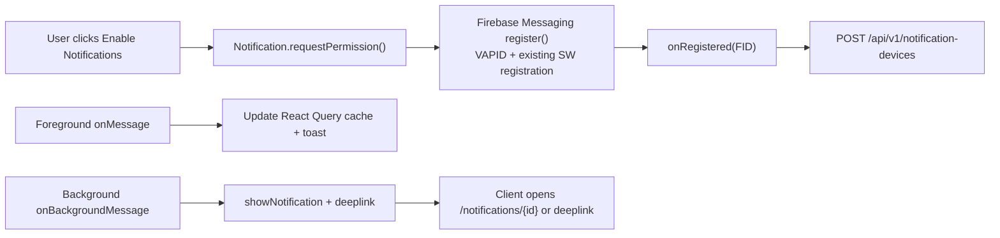

# Kế hoạch FE - Web/PWA Push Notification Firebase Cloud Messaging

Ngày lập: 2026-06-10, Asia/Saigon  
Source FE đã đọc: `D:\ERG\erg-system`  
Target: web desktop, mobile PWA, sau này fork sang desktop app bằng Tauri.

## 1. Kết luận FE

FE cần chuyển từ custom Web Push hiện tại sang Firebase Cloud Messaging (FCM) theo hướng FID-first. PWA vẫn giữ Workbox/vite-plugin-pwa cho caching/install/update, nhưng notification registration, foreground/background handling và device sync phải đi qua Firebase Messaging.

Thiết kế mong muốn:



Nguyên tắc FE:

- Không tự bắn Web Push subscription raw lên BE như hiện tại nữa, trừ khi fallback compatibility được yêu cầu.
- Dùng Firebase JS SDK modular API.
- Dùng `register()` + `onRegistered()` để nhận Firebase Installation ID (FID). `getToken()` chỉ là compatibility nếu backend cần registration token trong giai đoạn chuyển tiếp.
- Foreground message không nên tạo browser notification trùng; hiển thị toast/in-app inbox badge.
- Background message do service worker xử lý, click mở đúng route.
- Mọi thông báo click vào app sẽ fetch detail từ BE, không tin payload push là đủ dữ liệu.
- Permission UX phải mềm: giải thích trước, chỉ gọi browser permission sau hành động rõ ràng của user.

## 2. Reference Firebase mới nhất

Kiểm tra ngày 2026-06-10:

- FCM Web setup: https://firebase.google.com/docs/cloud-messaging/web/get-started, last updated 2026-06-09 UTC.
- Receive messages in Web apps: https://firebase.google.com/docs/cloud-messaging/web/receive-messages, last updated 2026-06-09 UTC.
- Firebase JS Messaging reference: https://firebase.google.com/docs/reference/js/messaging_, last updated 2026-05-28 UTC.
- Message types/payload: https://firebase.google.com/docs/cloud-messaging/customize-messages/set-message-type, last updated 2026-06-09 UTC.
- Token management: https://firebase.google.com/docs/cloud-messaging/manage-tokens, last updated 2026-06-09 UTC.
- Topic limits: https://firebase.google.com/docs/cloud-messaging/topic-messaging, last updated 2026-06-09 UTC.

Điểm quan trọng:

- FCM Web cần HTTPS vì service worker; `localhost`/local dev vẫn được hỗ trợ theo web platform.
- Firebase yêu cầu web credentials/VAPID key trong Firebase Console.
- Tài liệu 2026 khuyến nghị `register()` + `onRegistered()` cho FID. `getToken()` và `deleteToken()` đã bị đánh dấu obsolete trong JS reference.
- `register()` nhận options cùng shape với `GetTokenOptions`, bao gồm VAPID key và service worker registration.
- Background service worker có thể dùng modular SDK nếu được bundle; nếu không bundle, dùng compat `importScripts`.
- Nếu muốn custom `notificationclick`, phải đăng ký handler trước khi import FCM functions/libraries, vì FCM có thể override click behavior.

## 3. Hiện trạng FE

Các file liên quan:

- `package.json`
  - Có React 19, Vite 8, TanStack Query/Router, Tailwind 4, `vite-plugin-pwa`.
  - Chưa có dependency `firebase`.
- `vite.config.ts`
  - Đang dùng `VitePWA({ registerType: "autoUpdate", workbox.importScripts: ["pwa-push.js"] })`.
  - Có caching runtime cho LMS/HocLieu.
  - `devOptions.enabled=false`.
- `public/pwa-push.js`
  - Custom listener `push` và `notificationclick`.
  - Không khởi tạo Firebase Messaging.
- `src/features/lms/mobile/hooks/use-pwa-notifications.ts`
  - Dùng `PushManager.subscribe()` với `VITE_WEB_PUSH_PUBLIC_KEY`.
  - Gửi subscription lên `/api/lms/push-subscriptions`.
  - Đây là mô hình Web Push tự quản, chưa đúng FCM Web SDK mới.
- `src/features/lms/mobile/components/lms-pwa-setup-sheet.tsx`
  - Đã có UX enable notification/install PWA.
- `src/features/lms/components/lms-notification-center.tsx`
  - Dữ liệu mock `lmsNotifications`, chưa fetch API.
- `src/features/lms/components/lms-notification-detail-page.tsx`
  - Cũng dùng mock.
- Student dashboard/Elearning cũng có notification menu local state, chưa dùng inbox chung.

Khoảng trống:

- Chưa có Firebase config env.
- Chưa có Firebase app/messaging module.
- Chưa có FID registration lifecycle.
- Chưa sync device registration với BE mới.
- Chưa handle foreground `onMessage`.
- Service worker hiện tại chưa FCM-aware.
- Mock notification UI chưa nối API thật.
- Text tiếng Việt trong một số LMS notification file đang có dấu hiệu mojibake/encoding; khi chạm vào nên sửa về UTF-8.

## 4. Dependency và env

Thêm dependency FE:

```json
{
  "dependencies": {
    "firebase": "^12.14.0"
  }
}
```

Lý do: Firebase Web docs hiện đang dùng modular SDK và JS reference 2026 nêu API `register`, `onRegistered`, `onUnregistered`.

Env public cho Vite:

```env
VITE_FIREBASE_API_KEY=
VITE_FIREBASE_AUTH_DOMAIN=
VITE_FIREBASE_PROJECT_ID=
VITE_FIREBASE_STORAGE_BUCKET=
VITE_FIREBASE_MESSAGING_SENDER_ID=
VITE_FIREBASE_APP_ID=
VITE_FIREBASE_MEASUREMENT_ID=
VITE_FIREBASE_VAPID_KEY=
```

Không đưa secret server/service-account vào FE. Firebase web config không phải service secret, nhưng vẫn nên tách theo environment.

Deprecate:

- `VITE_WEB_PUSH_PUBLIC_KEY` chỉ dùng nếu giữ fallback Web Push cũ trong thời gian chuyển tiếp.

## 5. Service worker strategy

### Quyết định khuyến nghị

Chuyển `vite-plugin-pwa` từ `generateSW + workbox.importScripts` sang `injectManifest` với service worker TypeScript được bundle.

Lý do:

- Firebase docs nói modular SDK trong service worker cần bundle do ES modules trong SW chưa đủ rộng.
- Hiện `pwa-push.js` đang là script rời, khó dùng modular Firebase an toàn.
- `injectManifest` giúp Workbox caching và Firebase background messaging sống chung trong một SW duy nhất.

Đề xuất file:

- `src/platform/pwa/firebase-messaging-sw.ts`
- Generated output: `/sw.js` hoặc `/firebase-messaging-sw.js` tùy vite-plugin-pwa config.
- Nếu Firebase SDK client cần đúng root file, truyền `serviceWorkerRegistration` vào `register()` để dùng registration hiện có.

### Yêu cầu thứ tự trong SW

Nếu cần custom click:

1. Đăng ký `self.addEventListener("notificationclick", ...)` trước.
2. Sau đó initialize Firebase Messaging và `onBackgroundMessage`.

Pseudo:

```ts
self.addEventListener("notificationclick", (event) => {
  event.notification.close();
  const url = resolveSafeDeeplink(event.notification.data?.deeplink);
  event.waitUntil(openOrFocus(url));
});

const firebaseApp = initializeApp(firebaseConfig);
const messaging = getMessaging(firebaseApp);

onBackgroundMessage(messaging, (payload) => {
  const data = payload.data ?? {};
  self.registration.showNotification(payload.notification?.title ?? "ERG", {
    body: payload.notification?.body ?? "Bạn có thông báo mới.",
    icon: "/android-chrome-192x192.png",
    badge: "/android-chrome-192x192.png",
    tag: data.notificationId ?? data.eventType ?? "erg-notification",
    data: {
      notificationId: data.notificationId,
      deeplink: data.deeplink ?? "/notifications"
    }
  });
});
```

### Fallback nếu chưa kịp chuyển `injectManifest`

Vẫn có thể tạo `public/firebase-messaging-sw.js` dùng compat `importScripts` và bỏ dần `pwa-push.js`, nhưng phải kiểm tra kỹ scope/service worker registration để tránh 2 SW tranh scope `/`. Đây chỉ nên là giải pháp tạm.

## 6. FE module structure

Đề xuất thêm:

```text
src/platform/firebase/
  firebase-app.ts
  firebase-messaging.ts
  firebase-env.ts

src/features/notifications/
  api/notification-api.ts
  api/notification-query-keys.ts
  hooks/use-notification-inbox.ts
  hooks/use-notification-permission.ts
  hooks/use-firebase-notification-registration.ts
  hooks/use-foreground-messages.ts
  components/notification-center.tsx
  components/notification-list-page.tsx
  components/notification-detail-page.tsx
  components/notification-settings-sheet.tsx
  types/notification-types.ts

src/platform/pwa/
  firebase-messaging-sw.ts
  pwa-registration.ts
```

Sau đó LMS/Elearning import shared notification feature, không giữ mock riêng.

## 7. Firebase client initialization

`firebase-env.ts`:

- Validate đủ env trước khi enable.
- Không throw hard khi thiếu env ở build; trả state `unconfigured` để UI hiển thị "chưa cấu hình".

`firebase-app.ts`:

- Singleton `initializeApp(firebaseConfig)`.
- Không initialize Analytics nếu chưa cần.

`firebase-messaging.ts`:

- `isSupported()` trước khi gọi `getMessaging`.
- Lazy initialize để tránh crash SSR/test.
- Export:
  - `getFirebaseMessagingOrNull()`
  - `registerFirebaseMessaging(registration: ServiceWorkerRegistration)`
  - `subscribeOnRegistered(callback)`
  - `subscribeOnUnregistered(callback)`
  - `subscribeForegroundMessage(callback)`

Pseudo:

```ts
import { getMessaging, isSupported, onMessage, onRegistered, onUnregistered, register, unregister } from "firebase/messaging";

export async function enableFirebasePush(swRegistration: ServiceWorkerRegistration) {
  if (!(await isSupported())) return { state: "unsupported" as const };
  const permission = await Notification.requestPermission();
  if (permission !== "granted") return { state: permission };

  const messaging = getMessaging(getFirebaseApp());
  const unsubscribeRegistered = onRegistered(messaging, (fid) => {
    void registerDeviceWithBackend({ firebaseInstallationId: fid, swRegistration });
  });

  await register(messaging, {
    vapidKey: firebaseEnv.vapidKey,
    serviceWorkerRegistration: swRegistration
  });

  return { state: "enabled" as const, unsubscribeRegistered };
}
```

## 8. Device registration lifecycle

Thay `use-pwa-notifications.ts` hiện tại bằng hook mới:

`useFirebaseNotificationRegistration()`:

State:

- `unsupported`
- `unconfigured`
- `default`
- `requesting`
- `enabled`
- `blocked`
- `syncing`
- `failed`

Enable flow:

1. Check `Notification`, `serviceWorker`, Firebase `isSupported()`.
2. Check env Firebase/VAPID.
3. Wait `navigator.serviceWorker.ready`.
4. User click "Bật thông báo".
5. Call `Notification.requestPermission()`.
6. If granted: register Firebase Messaging with `serviceWorkerRegistration`.
7. `onRegistered(fid)` calls `POST /api/v1/notification-devices`.
8. Store local non-sensitive marker:
   - `erg-fcm-registration-state`
   - last FID hash or `registeredAt`, not raw token if not needed.
9. On app foreground/online: `POST /api/v1/notification-devices/heartbeat`.

Disable flow:

1. Call Firebase `unregister(messaging)` if available.
2. `onUnregistered(fid)` calls `POST /api/v1/notification-devices/unregister`.
3. Also call BE disable endpoint for current device if local `deviceRegistrationId` exists.
4. UI state returns to `default` or `blocked` based on browser permission.

Compatibility token:

- Không dùng `getToken()` làm core.
- Nếu BE team xác nhận Java Admin/HTTP v1 FID target chưa chạy trong sprint đầu, tạm gọi `getToken(messaging, { vapidKey, serviceWorkerRegistration })` và gửi `registrationToken` cùng FID. Gắn code comment `TODO remove when BE FID send is verified`.

## 9. API client FE

`notification-api.ts` dùng `apiRequest` hiện có.

Methods:

```ts
listNotifications(params): Promise<NotificationPage>
getNotification(id): Promise<NotificationDetail>
getUnreadCount(portal): Promise<{ unread: number }>
markNotificationRead(id): Promise<void>
markAllNotificationsRead(portal): Promise<void>
archiveNotification(id): Promise<void>
getNotificationPreferences(portal): Promise<NotificationPreference[]>
updateNotificationPreferences(portal, body): Promise<NotificationPreference[]>
registerNotificationDevice(body): Promise<NotificationDeviceRegistrationResponse>
unregisterNotificationDevice(body): Promise<void>
heartbeatNotificationDevice(body): Promise<void>
```

Endpoint map:

- `/api/v1/notifications`
- `/api/v1/notifications/unread-count`
- `/api/v1/notifications/{id}`
- `/api/v1/notifications/{id}/read`
- `/api/v1/notifications/read-all`
- `/api/v1/notifications/preferences`
- `/api/v1/notification-devices`
- `/api/v1/notification-devices/unregister`
- `/api/v1/notification-devices/heartbeat`

Portal:

- LMS teacher: `portal: "lms"`.
- Elearning student: `portal: "elearning"`.
- Admin/LCMS/CRM later reuse.

## 10. React Query state

Query keys:

```ts
["notifications", portal, filters]
["notifications", "unread-count", portal]
["notifications", "detail", id]
["notifications", "preferences", portal]
```

Foreground message handling:

- `onMessage` nhận payload.
- Extract `notificationId`, `eventType`, `deeplink`.
- Invalidate unread count.
- Prepend lightweight item nếu inbox list đang mở, hoặc invalidate list.
- Show `sonner` toast với title/body ngắn.
- Toast click navigate tới `deeplink` hoặc `/notifications/{notificationId}`.
- Không hiện browser `new Notification()` khi page foreground, tránh double notification.

Background click:

- Service worker mở/focus route.
- App route mount sẽ fetch detail từ BE.
- Nếu `notificationId` có trong query string, mark read sau khi load thành công.

## 11. UI/UX chỉnh sửa

### LMS teacher

Thay mock trong:

- `src/features/lms/components/lms-notification-center.tsx`
- `src/features/lms/components/lms-notification-detail-page.tsx`
- `src/features/lms/components/lms-teacher-shell.tsx`

Yêu cầu:

- Badge unread lấy từ API.
- Popover chỉ lấy 3-5 latest notifications.
- Trang `/notifications` fetch paginated list.
- Detail fetch `/api/v1/notifications/{id}`.
- Mark read khi user mở notification.
- Empty/loading/error states rõ ràng.
- Không để mojibake tiếng Việt; sửa encoding khi refactor.

### Mobile PWA

`lms-pwa-setup-sheet.tsx` giữ UX hiện có nhưng cập nhật copy:

- `unconfigured`: thiếu Firebase config/VAPID.
- `blocked`: hướng dẫn mở Site Settings.
- `unsupported`: browser không hỗ trợ FCM/Web Push.
- `enabled`: đã bật trên thiết bị này.
- Button "Bật thông báo" chỉ request permission khi user click.

### Elearning student

Student dashboard hiện có local `discussionNotifications`. V1 nên:

- Giữ discussion local nếu chưa có backend event.
- Thêm inbox chung cho announcements/assignments/support-needed.
- Unread badge student lấy `/api/v1/notifications/unread-count?portal=elearning`.
- Route detail dùng shared component nhưng style phù hợp mobile/student.

## 12. Tauri desktop path

Không khóa FE vào service worker cho Tauri.

V1 Web/PWA:

- Adapter: `webPwaNotificationAdapter`.
- Dùng Firebase Messaging + service worker.

Tauri sau này:

- Adapter: `tauriNotificationAdapter`.
- Dùng cùng BE inbox APIs.
- Native desktop notification dùng Tauri notification plugin hoặc OS-specific adapter.
- Nếu Tauri không hỗ trợ FCM Web service worker theo cách ổn định, không ép dùng FCM Web trong WebView. Thay vào đó:
  - App polling/long-poll/SSE inbox trong foreground.
  - Native push adapter sau khi chọn distribution channel.
  - Vẫn có `notification_device_registrations.platform = tauri_desktop`.

Thiết kế shared:

```ts
interface NotificationRuntimeAdapter {
  isSupported(): Promise<boolean>;
  enable(): Promise<EnableNotificationResult>;
  disable(): Promise<boolean>;
  heartbeat(): Promise<void>;
  onForegroundMessage(callback: NotificationMessageHandler): Unsubscribe;
}
```

## 13. Offline/PWA behavior

Yêu cầu:

- App mở từ notification khi offline phải render shell và hiển thị trạng thái "chưa tải được nội dung".
- Khi online lại, fetch detail và mark read.
- Không cache API notification detail quá lâu; dùng NetworkFirst hoặc no-store tùy route.
- Không cache endpoint auth/session/notification mutation.
- Service worker update không được mất background message handler.

VitePWA runtime caching cần review:

- Các API `GET /api/v1/notifications*` nên NetworkFirst ngắn hoặc no-store nếu cần realtime.
- Mutation `/api/v1/notifications/*/read`, `/api/v1/notification-devices*` phải NetworkOnly.

## 14. Testing plan FE

Unit/Vitest:

- Env validation.
- API client request paths/portal headers.
- Hook states: unsupported/unconfigured/default/enabled/blocked/failed.
- Foreground message invalidates query keys.
- Click deeplink sanitizer không mở external URL độc hại.

Service worker tests:

- Có thể dùng Playwright/e2e hoặc worker unit harness.
- `notificationclick` focus tab hiện có.
- `notificationclick` mở window mới nếu chưa có tab.
- `onBackgroundMessage` showNotification với title/body/icon/tag đúng.

Manual browser matrix:

- Chrome desktop HTTPS.
- Chrome Android PWA installed.
- Edge desktop.
- Safari iOS: kiểm tra khả năng push theo điều kiện iOS/PWA install; UX phải xử lý unsupported/blocked gracefully.

Load/UX:

- 5.000 concurrent đọc unread/list không làm UI polling quá dày.
- Không poll unread count mỗi giây; dùng TanStack Query stale time 30-60 giây + foreground message invalidation.

## 15. Roadmap FE

### Phase 0 - Chuẩn bị Firebase env

- Thêm `firebase` dependency.
- Thêm env types cho `VITE_FIREBASE_*`.
- Tạo `firebase-env.ts`, `firebase-app.ts`, `firebase-messaging.ts`.
- Bổ sung `.env.example` của FE.

Done khi:

- Build/typecheck pass khi env thiếu.
- UI nhận state `unconfigured` thay vì crash.

### Phase 1 - Service worker FCM-aware

- Chọn `injectManifest`.
- Tạo `src/platform/pwa/firebase-messaging-sw.ts`.
- Di chuyển logic `pwa-push.js` vào SW mới.
- Đảm bảo Workbox caching hiện tại không mất.
- Đăng ký click handler trước Firebase background handler.

Done khi:

- PWA install/update vẫn hoạt động.
- Background push hiển thị notification.
- Click notification mở đúng route.

### Phase 2 - Registration lifecycle

- Thay `use-pwa-notifications.ts` bằng FID-first hook.
- Gọi `register()` + `onRegistered()`.
- POST FID/device metadata lên BE.
- Heartbeat khi app foreground/online.
- Disable/unregister flow.
- Compatibility token chỉ bật bằng feature flag nếu BE cần.

Done khi:

- Register nhiều lần không duplicate BE.
- Browser denied/blocked hiển thị đúng.
- Logout hoặc disable dừng gửi đến device.

### Phase 3 - Inbox API integration

- Tạo `features/notifications`.
- Thay mock LMS notification center/list/detail bằng API.
- Thêm shared unread count.
- Foreground `onMessage` invalidate cache + toast.
- Route notification detail mark read.

Done khi:

- LMS teacher nhận và đọc notification thật.
- Badge unread đồng bộ desktop/mobile.
- Không còn dùng `lmsNotifications` mock cho flow thật.

### Phase 4 - Elearning/student

- Dùng shared inbox cho student assignments/announcements/support-needed.
- Giữ discussion local nếu chưa có BE event, nhưng tách rõ khỏi inbox FCM.
- Mobile UX cho học sinh: concise, action rõ, không lộ dữ liệu nhạy cảm trên push.

Done khi:

- Student nhận assignment mới, due soon, graded/support-needed.
- Push click mở đúng màn hình học sinh.

### Phase 5 - Hardening/Tauri adapter

- Tạo `NotificationRuntimeAdapter`.
- Web/PWA adapter là implementation đầu.
- Tauri adapter placeholder dùng inbox polling/SSE/native notification sau.
- Add e2e Playwright cho permission mock, foreground message mock, notification click.

Done khi:

- Code FE không phụ thuộc trực tiếp vào `navigator.serviceWorker` ngoài adapter.
- Fork Tauri không phải rewrite toàn bộ notification UI.

## 16. Tiêu chí nghiệm thu FE

- Không dùng `PushManager.subscribe()` custom làm flow chính.
- Không dùng `getToken()` làm identity chính nếu BE FID target đã chạy.
- Khi user chưa click enable, không gọi browser permission prompt.
- Khi thiếu Firebase env, app vẫn chạy và báo `unconfigured`.
- Foreground message không tạo notification trùng.
- Background notification click mở đúng route HTTPS/internal.
- Inbox luôn fetch detail từ BE.
- LMS và Elearning dùng shared notification API thay vì mock.
- Tauri path đã có adapter boundary.

