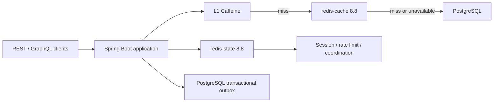

# ERG Redis 8.8 Upgrade and Distributed Cache Design

**Status:** Approved design direction on 2026-07-16; written specification awaiting final review

**Scope:** Spring Boot code, Redis-backed cache and rate limiting, Docker Compose, Native Image compatibility, observability, destructive local migration, and performance acceptance

**Audience:** Backend engineers, platform engineers, QA/performance engineers, and operators

**Baseline:** Redis 7.4.9 standalone in Docker, Spring Boot 4.0.6, Spring Data Redis 4.0.5, Lettuce 6.8.2, PostgreSQL 17, Java 25, and GraalVM Native Image

## 1. Decision summary

ERG will upgrade from Redis 7.4 to the exact Redis 8.8 patch image and split Redis into two independently configured containers:

- `redis-state` stores Spring Session state, distributed rate-limit counters, and short-lived coordination state. It uses AOF persistence and `noeviction`.
- `redis-cache` stores rebuildable business read-model cache entries. It does not require persistence and uses `allkeys-lfu` with mandatory TTLs.

The application will retain Caffeine as an L1 per-process cache and introduce Redis as an L2 distributed cache only for measured read-heavy business DTOs. PostgreSQL remains the authoritative data source. Redis is not a transactional system of record, reporting database, or durable queue.

Redis 8.8 `INCREX` will replace the current non-atomic `INCR` followed by conditional `EXPIRE` in the GraphQL fixed-window rate limiter. The application will use capability detection and a Redis 7.4-compatible Lua fallback so rollback remains possible even if the current Lettuce version has no typed `INCREX` method.

The local system has no production users or session continuity requirement. The initial Redis migration is therefore destructive: stop the old Redis service, remove its local volume, and create clean Redis 8.8 state/cache volumes.

This work does not change REST or GraphQL response payloads. No frontend migration guide is required unless implementation uncovers an unavoidable API contract change; such a change requires separate approval before it is made.

## 2. Current-state findings

### 2.1 Runtime and Docker

The inspected local container is `erg-dev-redis-1`, running Redis 7.4.9 from `redis:7.4-alpine` in standalone mode. The current command enables AOF, configures `requirepass`, and sets `maxmemory-policy noeviction`, but does not configure `maxmemory`.

The current Redis instance combines all potential responsibilities in one process and one database. Its Docker volume is mounted at `/data`. Redis memory use is currently tiny because the local dataset contains almost no Redis state, so current memory statistics are not capacity evidence.

The Compose definition is in:

- `ops/docker/compose.yml`
- `ops/docker/compose.dev.yml`
- `ops/docker/.env.dev`

### 2.2 Spring usage

`CacheConfig` creates a `SimpleCacheManager` containing only Caffeine caches. Therefore, existing `@Cacheable` business caches are per-JVM and cannot be shared or invalidated consistently across future application replicas.

Redis is currently used or configured for:

- optional Spring Data Redis connectivity;
- Spring Session dependency;
- GraphQL rate limiting when `ERG_GRAPHQL_RATE_LIMIT_REDIS_ENABLED=true`;
- health/readiness checks;
- queue-related environment properties.

GraphQL Redis rate limiting is disabled by default. When enabled, `GraphQlRateLimiter` executes `INCR`, then executes `EXPIRE` only when the returned count is one. A process or connection failure between those commands can leave a counter without a TTL. The class documentation also calls the algorithm a sliding window even though the implementation is a fixed time window.

The source contains many `@CacheEvict(allEntries = true)` mutations. These broad invalidations are tolerable only in a single small JVM cache. With distributed cache and multiple tenants, they would cause avoidable global cold-cache storms.

### 2.3 Compatibility facts

Spring Boot 4.0.6 currently resolves Spring Data Redis 4.0.5 and Lettuce 6.8.2. Redis protocol compatibility allows those clients to connect to Redis 8.8, but the client may not expose a typed API for commands introduced after that client release. New Redis 8.8 commands must therefore be isolated behind application-owned interfaces and exercised through low-level command execution where necessary.

Generic Java serialization is not permitted for L2 cache values. Cached values must use explicit JSON codecs and known DTO types so deserialization remains safe, versionable, and compatible with Native Image reachability analysis.

## 3. Redis 8.8 feature disposition

| Redis 8.8 capability | ERG decision | Reason |
|---|---|---|
| `INCREX` | Adopt immediately | Makes increment, upper bound, and expiration one atomic O(1) operation for fixed-window rate limiting |
| Faster `MGET`/`MSET` | Use when a measured read model needs bulk cache access | Helps batch fetches but does not justify rewriting simple single-key reads |
| Faster `HGETALL` | Opportunistic only | ERG will initially store typed values as bounded string keys, not large unbounded hashes |
| Core security and bug fixes | Adopt | Reduces exposure to defects fixed after Redis 7.4 |
| `XNACK` | Do not adopt now | PostgreSQL transactional outbox remains the durable job/event source |
| Search and Query | Do not adopt now | PostgreSQL search/read models avoid dual-write and synchronization complexity |
| JSON data structure | Do not adopt now | Plain typed JSON cache values are sufficient; Redis is not the source of truth |
| Time Series | Do not adopt now | Metrics remain in the observability stack; reporting truth remains PostgreSQL |
| Bloom/probabilistic structures | Do not adopt now | No measured use case currently offsets false-positive and operational complexity |
| Array structure | Do not adopt now | No current workload requires Redis-native indexed arrays |
| Hash field notifications | Do not adopt now | Application-owned invalidation messages are explicit and testable |
| Sentinel/Cluster | Defer | Multiple Redis processes on one physical host do not provide host-level high availability |

Redis 8 uses a tri-license choice that includes AGPLv3, RSALv2, and SSPLv1. The chosen deployment/license interpretation must be reviewed before an external production launch. The current local development upgrade may proceed.

## 4. Target architecture



### 4.1 Responsibility boundaries

`redis-state` is correctness-sensitive infrastructure. It must not evict data silently. A full state instance must reject writes and raise alerts rather than discard sessions or counters.

`redis-cache` is an optimization. Its keys may expire or be evicted at any time. Cache failures must not corrupt business behavior. Reads fall back to PostgreSQL through a bounded circuit breaker path; writes do not depend on successfully populating cache.

PostgreSQL remains authoritative for users, assignments, attempts, questions, learning content, reports, outbox events, and all durable workflow state.

### 4.2 Initial resource profiles

For the approved minimum 16 GiB host:

| Service | Redis `maxmemory` | Container memory limit | Policy |
|---|---:|---:|---|
| `redis-state` | 768 MiB | 1.25 GiB | `noeviction` |
| `redis-cache` | 2 GiB | 2.5 GiB | `allkeys-lfu` |

For a future 32 GiB-or-larger host:

| Service | Redis `maxmemory` | Container memory limit | Policy |
|---|---:|---:|---|
| `redis-state` | 1.5 GiB | 2 GiB | `noeviction` |
| `redis-cache` | 6 GiB | 7 GiB | `allkeys-lfu` |

`maxmemory` is intentionally lower than the container limit. The difference is reserved for allocator fragmentation, client buffers, AOF rewrite buffers, fork copy-on-write, command execution, and other memory not fully governed by Redis key eviction.

The 16 GiB profile preserves approximately 6 GiB for PostgreSQL, 2-2.5 GiB for the application/workers, and at least 3 GiB for the operating system, Docker, reverse proxy, and observability. These are starting budgets, not proof of 5,000-user capacity.

### 4.3 Docker configuration

Both Redis services will use `redis:8.8.0-alpine3.23`. Production-like manifests must pin the resolved multi-platform or architecture-specific digest after image verification; floating tags such as `8`, `8.8`, or `latest` are prohibited.

The base Compose network does not publish Redis externally. Development overrides may bind:

- `redis-state` to `127.0.0.1:6379`;
- `redis-cache` to `127.0.0.1:6380`.

`redis-state` configuration:

- `appendonly yes`;
- `appendfsync everysec`;
- bounded AOF rewrite settings;
- `maxmemory-policy noeviction`;
- RDB snapshots retained only if they do not cause unacceptable host memory pressure;
- a dedicated volume.

`redis-cache` configuration:

- `appendonly no`;
- scheduled RDB persistence disabled;
- `maxmemory-policy allkeys-lfu`;
- mandatory TTL on application-created keys;
- a separate disposable volume or no durable volume.

Healthchecks use `REDISCLI_AUTH` or an ACL-aware equivalent, not `redis-cli -a`, so credentials are not printed in command warnings. Secrets must not be committed in production files or passed as visible process arguments. Local example credentials remain explicitly development-only.

Host runbooks must cover `vm.overcommit_memory`, transparent huge pages, file descriptor limits, backlog settings, disk space for AOF, and Docker restart behavior. Windows Docker Desktop development limitations must be documented separately from the Linux server configuration.

## 5. Application cache design

### 5.1 Cache tiers

The cache manager will implement a true two-level cache rather than using `CompositeCacheManager`, which only falls through between managers and does not provide L1/L2 population semantics.

For a read:

1. Build a canonical, tenant-aware key.
2. Read L1 Caffeine.
3. On L1 miss, read L2 Redis.
4. On L2 hit, decode the known DTO type and populate L1.
5. On L2 miss or an open Redis circuit, load once from PostgreSQL.
6. Populate L2 and L1 only after a successful database result.

For a mutation:

1. Commit the PostgreSQL transaction.
2. Invalidate exact entity/read-model keys where cardinality is bounded.
3. Increment a tenant/domain generation for broad query families where exact result keys cannot be enumerated safely.
4. Publish a best-effort invalidation message so other application replicas clear matching L1 entries.
5. Rely on short L1 TTL as a bounded safety net if an invalidation message is missed.

Cache population and invalidation failures do not roll back a successful business transaction. Security-sensitive revocation paths must remain fail-closed through authoritative checks rather than trusting a stale allow decision.

### 5.2 Key format

All distributed business keys follow a versioned namespace:

```text
erg:cache:v2:{tenantId}:{cacheName}:g{generation}:{canonicalKeyHash}
```

State keys use a separate namespace:

```text
erg:state:v1:session:{sessionId}
erg:state:v1:graphql-rate-limit:{digest}:{windowStart}
erg:state:v1:cache-generation:{tenantId}:{cacheName}
erg:state:v1:cache-invalidation
```

The tenant identifier is mandatory for tenant-owned data. Canonical keys must not depend on unordered `Set.toString()` output. IDs are sorted and encoded deterministically before hashing. Raw PII, tokens, query text, or user-supplied search content must not appear in Redis key names.

### 5.3 Serialization and size limits

Each L2-enabled cache has an explicit descriptor containing:

- cache name;
- value Java type/`JavaType`;
- L1 TTL and weight budget;
- L2 TTL;
- maximum serialized value size;
- null/empty-result policy;
- tenant and scope key requirements.

The default maximum serialized entry is 1 MiB. Larger values bypass L2 and emit a size-rejection metric. No JPA entity, Hibernate collection, lazy proxy, `Page` implementation, input stream, or security credential is serializable into Redis.

Serialization uses the application-managed Jackson configuration with explicit DTO type registration. Native Image runtime hints cover only the DTO constructors/properties required by the approved descriptors. Java native serialization and unconstrained polymorphic default typing are prohibited.

### 5.4 Initial cache rollout

The first L2 candidates are read-heavy, rebuildable DTOs already represented by Caffeine cache names:

- `studentDashboard`;
- `lmsClassWorkspace`;
- `lmsHomeworkWorkspace`;
- `lmsAssignmentProgress`;
- `lmsStudentGroups`;
- `lcmsQuestionBankWorkspace`;
- `lcmsQuizWorkspace`;
- `lcmsSchoolDirectory`;
- `quizRuntimePackage`;
- `quizQuestionAnalytics`;
- `quizAssignmentReport`;
- `organizationEducationUnits`;
- `calendarWorkspace`.

Rollout is per cache and feature-flagged. A cache is enabled in L2 only after its key isolation, serialization, invalidation, cold/warm correctness, value-size distribution, and benchmark tests pass.

Authorization allow decisions are excluded. Principal/session bootstrap data may remain short-lived L1 data initially; any later L2 migration requires exact user/tenant invalidation and revocation tests.

### 5.5 Stampede and failure control

Each process uses single-flight loading per complete cache key. The loader has bounded waiting and never occupies unlimited virtual/platform threads. Optional short distributed lock use is limited to expensive read models and must have ownership tokens and atomic unlock; ordinary cache entries do not justify a distributed lock.

Redis cache failures use a circuit breaker with short connect/read timeouts. When open, requests go directly to bounded PostgreSQL loading rather than attempting Redis for every call. The fallback path must still obey Hikari and read-executor limits, preventing a Redis outage from becoming a database stampede.

Negative caching is allowed only for explicitly safe not-found reads with very short TTLs. Authorization denied/allowed decisions and transient dependency failures are not negative-cached as business truth.

## 6. Redis 8.8 rate limiter

The GraphQL limiter remains a fixed 60-second window. Its Redis operation is logically:

```text
INCREX <key> BYINT 1 UBOUND <limit> PXAT <windowEndEpochMillis> ENX
```

`ENX` sets expiration only when the key has no TTL, so requests do not extend the fixed window. `PXAT` expires the counter at the exact wall-clock window boundary even when the first request arrives late in that window. `UBOUND` prevents increments above the accepted limit. The returned actual increment determines whether the request is allowed without a second read.

Application components:

- `GraphQlRateLimitCounter`: version-independent interface;
- `Redis88IncrexRateLimitCounter`: low-level `INCREX` adapter;
- `LuaFixedWindowRateLimitCounter`: atomic Redis 7.4 fallback;
- `LocalEmergencyRateLimitCounter`: bounded per-process outage fallback;
- `RedisCapabilityDetector`: caches `COMMAND INFO INCREX` result at startup and reconnect.

The current response contract remains HTTP 429 with `Retry-After`. No GraphQL error or REST payload shape changes.

If Redis state fails and `fail-closed-on-redis-error=true`, expensive GraphQL operations are rejected conservatively. A separately configured local emergency allowance may serve low-risk traffic, but it must not silently turn distributed limits into unlimited per-replica limits.

## 7. Spring connection and configuration model

State and cache connections must be independently named and configurable:

- `ERG_REDIS_STATE_URL` / `spring.data.redis` for Spring Session and state operations;
- `ERG_REDIS_CACHE_URL` for the custom L2 cache connection factory;
- separate pool size, connect timeout, command timeout, database, TLS, username, and password properties;
- separate health indicators and metrics.

The state client pool must prioritize predictable low latency for session and limiter operations. The cache client may use a larger bounded pool only if load tests show connection wait. Increasing client connections is not a substitute for batching or fixing oversized values.

Redis auto-configuration remains opt-in for environments that intentionally run without Redis. Enabling L2 without a cache Redis URL fails configuration validation at startup. Disabling L2 leaves the existing L1 behavior available.

## 8. Security and ACL design

Redis is reachable only through the internal Docker network or loopback development bindings. It is never exposed directly to the public network.

Use distinct Redis ACL users and credentials for state and cache. Command permissions are allowlisted by required command families. Broad category grants must be reviewed because Redis 8 integrates Search, JSON, Time Series, and probabilistic commands, expanding the commands covered by some ACL categories compared with a core-only deployment.

Application users do not receive administrative commands such as `CONFIG`, `MODULE`, `DEBUG`, `SHUTDOWN`, replication changes, or destructive database-wide operations. Operations credentials are separate from application credentials.

Logs, metrics, exception messages, health responses, and documentation must not expose Redis URLs with embedded passwords. Key names contain hashes instead of PII.

## 9. Destructive local migration and rollback

Because there is no production state to preserve, the local cutover is:

1. Record the current Redis image/version and Compose configuration for evidence.
2. Stop the application and Redis 7.4 container.
3. Remove only the verified `erg-dev` Redis volume; do not remove PostgreSQL volumes.
4. Pull and verify Redis 8.8.0 images.
5. Start `redis-state` and `redis-cache` with clean volumes/configuration.
6. Run health, ACL, persistence, eviction, memory, and command capability checks.
7. Start the application with L2 disabled and rate limiter in compatibility mode.
8. Enable Redis 8.8 `INCREX` and then enable each L2 cache family incrementally.

Rollback uses the retained Compose configuration to recreate a clean Redis 7.4 container and selects the Lua limiter. Business cache and local sessions may be discarded. PostgreSQL is unaffected.

Any future production migration requires a separate state-preserving runbook and cannot reuse this destructive local procedure.

## 10. Observability

Application metrics include:

- L1 hit, miss, eviction, load latency, and approximate weight;
- L2 hit, miss, command latency, timeout, error, circuit state, and fallback;
- serialization/deserialization latency and byte size;
- entries rejected for exceeding the size limit;
- exact and generation invalidations;
- invalidation message receive/miss indicators where observable;
- single-flight waiters and database loader executions;
- rate-limit allowed, rejected, Redis 8.8, Lua fallback, local fallback, and failure counts.

Redis operational monitoring includes:

- used memory, RSS, fragmentation, peak memory, and maxmemory ratio;
- connected/blocked clients and rejected connections;
- commands per second, command latency, errors, and slowlog;
- keyspace hits/misses, expired keys, and evicted keys;
- AOF size, rewrite status/duration/failure, and last write status for `redis-state`;
- CPU, network, file descriptors, container restarts, OOM kills, and disk free space.

Warnings fire at 70% of `maxmemory`; critical alerts fire at 85%. Any `redis-state` OOM/write rejection, failed AOF status, unexpected eviction, or container OOM kill fails the capacity run.

Cache eviction is expected only within the measured cache profile. Continuously rising eviction combined with falling hit rate fails acceptance even if API responses remain correct.

## 11. Testing and acceptance

### 11.1 Automated correctness tests

- Testcontainers starts the exact Redis 8.8.0 image.
- State and cache connection factories cannot cross-connect accidentally.
- Identical entity IDs in different tenants never share keys or values.
- Key generation is deterministic for differently ordered equivalent scope sets.
- L1/L2 miss, hit, fill, expiry, exact eviction, generation invalidation, and cross-replica invalidation are tested.
- Cache entries above 1 MiB bypass Redis.
- Unsupported DTO types fail descriptor validation at startup.
- Concurrent cache misses execute one bounded database load per process/key.
- Redis unavailable, timeout, malformed value, deserialization failure, and circuit recovery are tested.
- `INCREX` allows exactly the configured fixed-window capacity and preserves TTL semantics.
- Lua fallback matches `INCREX` externally observable behavior.
- Native Image can serialize/deserialize every enabled cache descriptor.

### 11.2 Performance comparisons

Run the same reproducible API workload in these modes:

1. L1 only with Redis business cache disabled;
2. Redis 7.4-compatible Lua/state path where required for comparison;
3. Redis 8.8 state with L2 cold;
4. Redis 8.8 state with L2 warm;
5. Redis cache unavailable during a controlled interval;
6. Redis state unavailable with fail-closed and configured emergency behavior.

The workload includes student dashboard, assignment list/detail, quiz runtime package, question bank, teacher workspace, reports, GraphQL combined queries, login/session, and submission bursts. It runs against the approved deterministic PostgreSQL fixture and records source revision, dirty-tree fingerprint, image digests, configuration, raw results, and timestamps.

### 11.3 Capacity gates

The 5,000-user requirement means concurrent user workflows, not automatically 5,000 requests per second. The load model must specify think time, arrival rate, connection count, endpoint mix, cache warmth, submission burst, and report contention.

Redis acceptance requires:

- zero cross-tenant or cross-user cache leakage;
- zero business correctness dependency on cached data;
- no Redis/container OOM kill;
- no unexpected `redis-state` evictions;
- no unbounded key without TTL in `redis-cache`;
- state memory below 70% warning in the steady run, or a documented measured resize before acceptance;
- cache memory below 85% and a stable useful hit rate;
- no database connection-pool collapse during Redis-cache failure;
- no material p95/p99 regression on uncached writes;
- a statistically meaningful p95 and PostgreSQL-load improvement for each L2-enabled cache family;
- successful JVM and Native Image authenticated smoke suites.

System-wide 5,000-concurrent acceptance remains governed by the existing API performance/scalability plan. Passing Redis benchmarks alone does not prove the single physical server can support 5,000 concurrent users.

## 12. Delivery sequence

1. Add exact Redis 8.8 Docker services, configuration, resource profiles, healthchecks, and destructive local migration scripts.
2. Add dual Redis connection properties/factories and capability detection.
3. Replace GraphQL `INCR + EXPIRE` with `INCREX`, Lua fallback, and corrected fixed-window documentation/tests.
4. Introduce typed cache descriptors, deterministic keys, metrics, and Native Image hints.
5. Implement L1/L2 cache behavior, circuit breaker, size cap, and stampede control.
6. Implement exact/generation invalidation and cross-replica L1 invalidation.
7. Migrate business cache families one at a time, replacing relevant broad `allEntries=true` invalidations.
8. Run JVM, Native Image, Redis failure, cold/warm cache, and 5,000-concurrent workload gates.
9. Record measured resource adjustments and retain the 16 GiB and 32 GiB profiles.

## 13. Explicit non-goals

- Redis does not replace PostgreSQL for business records, reporting truth, or transactional outbox.
- Redis Streams are not introduced solely to use `XNACK`.
- Redis Search/JSON/Time Series/Bloom/Array are not introduced without a separate measured use case.
- Sentinel or Redis Cluster is not deployed on the same physical host as a claim of high availability.
- Native Image is not treated as a database or cache latency optimization by itself.
- The upgrade does not change frontend payloads or error contracts.
- Redis memory is not increased until the rest of the 16 GiB host is forced into swap or unsafe memory pressure.

## 14. Success definition

This upgrade is complete only when:

- local Docker runs two pinned Redis 8.8 services with the approved memory and persistence policies;
- GraphQL rate limiting uses atomic Redis 8.8 behavior with a tested rollback fallback;
- selected read models use tenant-safe typed L1/L2 caching;
- broad cache-clearing paths touched by the rollout use exact or generation invalidation;
- Redis failures degrade predictably without corrupting data or exhausting PostgreSQL;
- JVM and Native Image verification pass;
- cold, warm, and failure load artifacts demonstrate the impact rather than assuming it;
- no API payload change has occurred, or any unavoidable change has a separately approved frontend migration document.
